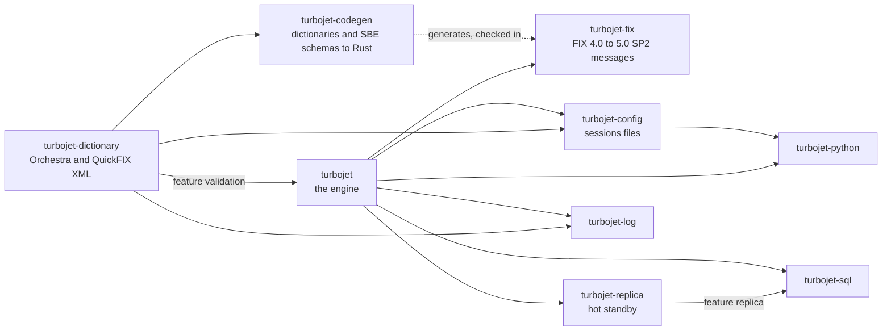
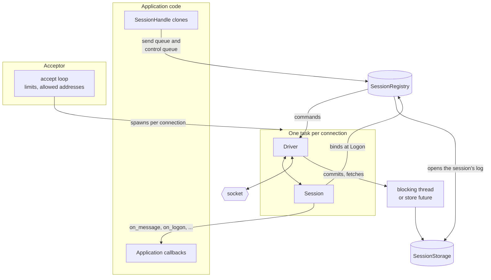
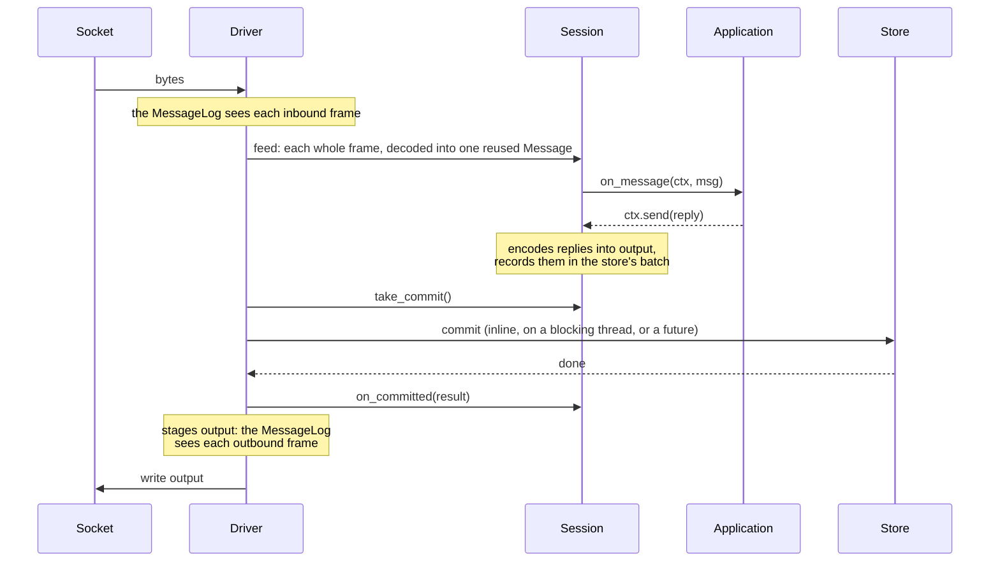
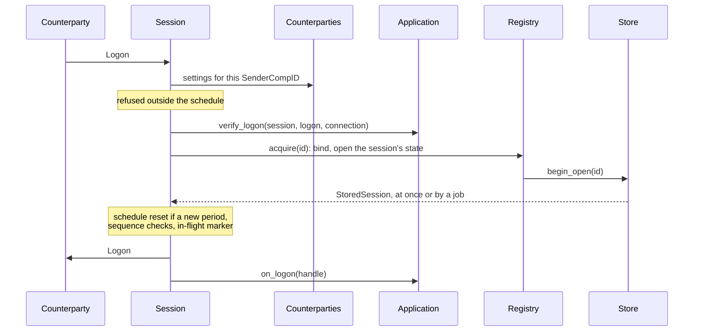

# Architecture

An overview of how Turbojet fits together, for working on it. [DESIGN.md](DESIGN.md) has the
details and the measurements behind each choice, [STYLE.md](STYLE.md) the house style, and
[the guide](guide/README.md) how to use it.

## The crates

An arrow points from a crate to one that depends on it. `turbojet` is the engine: codec, `Message`,
fields, the session state machine, the connection driver, the registry, the stores and the TCP
transports. `turbojet-fix` is generated by `turbojet-codegen` from the Orchestra files in
`dictionaries/orchestra` (`scripts/codegen.sh`) and checked in; CI fails if it differs from what
the generator makes. Not shown, since nothing depends on them: `turbojet-sim` (deterministic
simulation), `turbojet-acceptance` (QuickFIX's session scripts) and `turbojet-interop`
(QuickFIX/J and QuickFIX/n), which test the engine. The fuzz crate (`crates/turbojet/fuzz`) and
the Python bindings sit outside the workspace, with lock files of their own.

## Layers

The engine is built in layers, each public, so an application can use only the ones it needs:

| Layer | Where | What it does |
|---|---|---|
| Codec | `codec.rs` | Frames bytes into messages: BodyLength, CheckSum, resynchronising after garbage. |
| Messages | `message.rs`, `fields/`, `macros.rs`, `admin.rs` | `Message`, one buffer with an offset index; typed fields; the `fix_message!` macros; session messages. |
| Session | `session.rs` | The sans-IO FIX session state machine, for either role. |
| Driver | `connection.rs` | Runs a session over any async byte stream: reads, timers, commands, commits, writes. |
| Registry | `registry.rs` | Binds sessions to connections; `SessionHandle`s send through it; operator commands, status, events. |
| Stores | `store/` | `SessionStorage` opens a `StoredSession` per session: sequence numbers and sent messages. |
| Transports | `acceptor.rs`, `initiator.rs`, `tls.rs`, `proxy.rs` | TCP and TLS, connection limits, failover, reconnecting, shutdown. |
| FIXP | `fixp/` | The same shape for FIXP sessions carrying SBE: a sans-IO `FixpSession` run by the same driver. |
| FAST | `fast.rs`, `fast/` | FAST 1.1 market data decoded into and encoded from `Message`s, with templates loaded at runtime (feature `fast`). |

## The session is sans-IO

`Session` does no I/O and reads no clock of its own: every call is given `now`, an `Instant`, and
wall-clock time comes from the configured `Clock`. A driver calls it with what happened, and reads
back what to do:

- **In:** `on_connect`, `on_message` (each decoded frame), `on_command` (from the session's
  handle), `on_timer` (when `next_deadline` falls due), `on_resume` (the next step of a resend),
  `on_disconnect`, `on_shutdown`.
- **Out:** `output` (the encoded bytes to write, in order), `take_commit` (the store work the
  calls just did, to run before writing any of that output), `take_open` and `take_fetch` (store
  work to run off the runtime: opening the session's log at logon, reading a resend step),
  `next_deadline`, and `is_closed`.

The protocol's decisions are all in `session.rs`, so they're tested without sockets
(`session/tests.rs`), replayed from scripts (`turbojet-acceptance`), from logs
(`turbojet::replay`), and simulated (`turbojet-sim`), each driving the same `Session` its own way.
The driver decides only when to call it. `connection::Driven` is what the driver needs of a
session, and both `Session` and `FixpSession` implement it, so FIX and FIXP share one driver.

## At run time

- **One task per connection.** An acceptor's accept loop checks each connection against the
  connection limits and allowed addresses, then spawns a task that runs a driver and a fresh
  `Session::acceptor`. An initiator's `run` loops: connect (through endpoints in turn), run the
  driver until the connection ends, wait as the reconnect policy says. Application callbacks run
  on the connection's task, so they mustn't block.
- **The registry** knows which sessions are bound to a connection. At Logon the session asks it to
  bind its ID (`SessionRegistry::acquire`), which refuses a session already bound elsewhere or a
  counterparty with too many, and opens the session's stored state through the `SessionStorage`.
  A `SessionHandle` is the registry and an ID: it stays valid across reconnects, and sends go to
  whichever connection has the session bound, or are refused while none has. Operator commands
  on a disconnected session change its store directly, with the session claimed in the registry
  meanwhile so it can't log on half-way through.
- **Two queues per session.** Application sends go through a bounded send queue; logouts and
  operator commands through a small control queue of their own, so a full send queue never holds
  them up. Each send returns a `Receipt`, resolved once the session has stored the message.
- **Stores** are traits. `MemoryStorage` and `DiskStorage` are here, `SqlStorage` in
  `turbojet-sql`, and `StorageByCounterparty` routes sessions between others.
  `turbojet-replica`'s `ReplicatedStorage` wraps another, copying each commit to a standby's
  store, which can take the sessions over. A commit that waits
  for a device or a network is handed to the driver, which runs it on a blocking thread or awaits
  its future (`store::Job`), so the runtime never waits on a disk.

## One wake-up

Each time the driver wakes (input arrived, commands are waiting, or a deadline passed), it does one
batch of work, commits it once, and only then writes what it produced:

Nothing a batch sends is written before its commit, so a message is stored before the
counterparty can see it, and a failed commit disconnects with nothing of the batch written.
While a commit is under way, the driver reads on but feeds nothing. Reading and writing are
independent, so two ends writing to each other at once can't deadlock, and a counterparty that
stops reading is disconnected once 16 MiB waits for it.

Delivery to the application is at least once: an inbound message counts as received only once
`on_message` has returned and its replies are committed. Each commit records an in-flight marker
for up to 256 messages ahead, so after a crash the ones that may have been handled come back
marked `maybe_redelivered`. An application that finishes a message elsewhere holds the marker at
it with `Context::hold`.

A long resend is sent in steps of 256 sequence numbers, each read from the store (`take_fetch`)
and written before the next is read, so a ResendRequest for everything never holds the whole
range in memory. While `is_resending`, the driver writes and calls `on_resume` rather than feed
more input.

## Logon

This is an acceptor's. Its session's ID isn't known until the Logon (its CompIDs, SubIDs and
LocationIDs), so the session is created unbound and binds then. An initiator knows its ID from
the start, so it binds on connecting, before sending its Logon (whose MsgSeqNum comes from the
store), and checks the counterparty's reply with `verify_logon`. A refusal at any step closes the
connection with the reason logged; refusals the registry makes (already connected, too many
sessions, paused, a store that won't open) are also published as `SessionEventKind::Refused`.

## Where things are decided

| To change | Look at |
|---|---|
| What the session does with a message | `Session::on_message` and the handlers it calls in `session.rs`, with a test in `session/tests.rs` and, if a QuickFIX script covers it, `turbojet-acceptance`. |
| How bytes become messages | `codec.rs` (framing) and `message.rs` (fields and parsing). |
| When the driver reads, writes and commits | `drive` and `Driver` in `connection.rs`. |
| Binding, handles, operator commands, events | `registry.rs`. |
| A store's format | `store/disk.rs`, `store/memory.rs`, `turbojet-sql`; every store passes `store::conformance`. |
| Settings | `SessionConfig` (`session.rs`), `AcceptorConfig`, `InitiatorConfig`; and the sessions file's keys in `turbojet-config`. |
| Generated messages | `turbojet-codegen` and `scripts/codegen.sh`, never `turbojet-fix/src/fix*/` by hand. |

## How it's tested

| Test | Where | Finds |
|---|---|---|
| Unit and session tests | each module, `session/tests.rs` | Each rule, against the sans-IO session. |
| QuickFIX's acceptance scripts | `turbojet-acceptance` | Deviations from the FIX session test cases. |
| Interop | `turbojet-interop` (`scripts/interop.sh`) | Disagreements with QuickFIX/J and QuickFIX/n, over a hostile proxy and TLS. |
| Deterministic simulation | `turbojet-sim` (`scripts/sim.sh`) | Bugs in the session, driver and stores under faults, crashes and power loss, replayable from a seed. |
| Fuzzing | `crates/turbojet/fuzz` (`scripts/fuzz.sh`) | Panics and broken invariants in the parsers and session state machines. |
| Concurrency | `--cfg shuttle` tests | Races in the registry's and holds' locks and atomics, and in replication's link and catch-up. |
| Model checking | `specs/` (`specs/check.sh`) | Flaws in the replication protocol's design: fencing, failover, catching a standby up, redelivery after a takeover. |
| Allocations | `tests/allocations.rs` | Any change, up or down, in allocations per order by stage. |
| The guide's examples | `src/guide.rs` | Documentation that no longer compiles or runs. |

`scripts/check.sh` runs what CI runs on every push; long fuzzing and random simulation seeds run
nightly.
